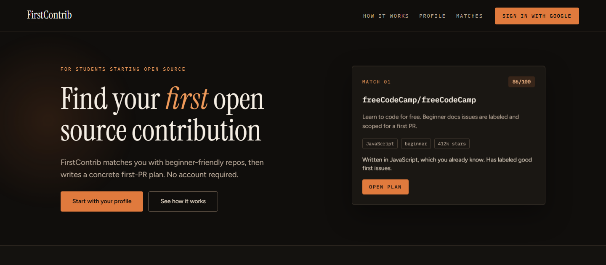
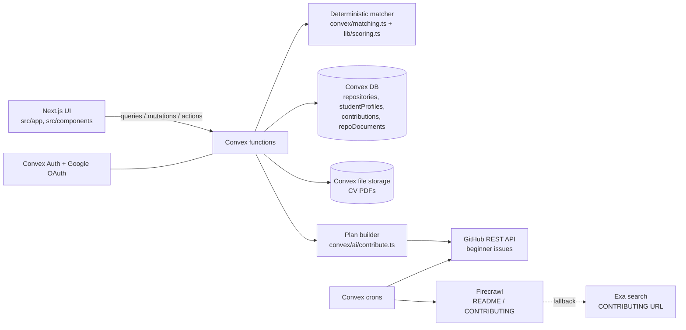

# FirstContrib

[](https://github.com/damnilo/Cursor-Hackathon/actions/workflows/ci.yml)

FirstContrib matches a developer with a beginner-friendly open-source repository and turns it into a concrete first-contribution plan.



> **Status:** hackathon prototype built by a team at a Cursor hackathon. It demonstrates the product and its architecture; it is not a maintained production service.
>
> Live demo: [firstcontrib-gbna.onrender.com](https://firstcontrib-gbna.onrender.com) (Render free tier, so the first request after idle can take ~40 s).

## Problem

The first pull request is the hard part. GitHub is full of repositories, and almost none of them tell a newcomer where to start: which project fits the languages they already know, which issue is small enough, and what the actual steps are.

## How it works

```text
Profile → deterministic matching → GitHub beginner issue → contribution plan → next plan
```

1. **Profile** (`/profile`): pick languages, stack, topics, level (beginner / intermediate) and whether you want a *good first issue*. A PDF CV can prefill the chips. Works as a guest; Google sign-in keeps the profile across browsers.
2. **Matching** (`/matches`): `api.matching.matchRepos` filters and scores a curated catalog of **58** repositories and shows the top 5 with plain-language reasons ("Written in TypeScript, which you already know").
3. **Plan** (`/matches/[repositoryId]`): the app fetches open `good first issue` issues for the chosen repo from the GitHub API, picks one, and builds steps from the repo's cached README / CONTRIBUTING.
4. **Next plan**: after the first plan is marked completed, a follow-up plan targets a different issue.
5. **Fixtures** (`/fixtures`): hard-coded sample personas run through the same matcher, for demoing and sanity checks.

Matching is deterministic and explainable. In the current code no step calls an LLM: the xAI Grok client (`convex/ai/lib/grok.ts`) and the AI rerank storage are still present, but "Refresh recommendations", CV parsing and plan generation all run without the model (see [Matching](docs/matching.md)).

## Architecture



| Component | Responsibility |
|---|---|
| `src/app/` | Next.js App Router pages: landing, `/profile`, `/matches`, `/matches/[repositoryId]`, `/fixtures` |
| `src/components/` | UI: auth, profile form, match list and detail, landing sections |
| `src/lib/` | Client helpers: guest session id (`session.ts`), shared catalogs and match types |
| `convex/schema.ts` | Data model ([docs/data-model.md](docs/data-model.md)) |
| `convex/matching.ts`, `convex/lib/scoring.ts` | The single official matcher and its scoring |
| `convex/profiles.ts` | Guest sessions, Google identity linking/merge, CV upload |
| `convex/contributions.ts`, `convex/ai/contribute.ts` | Plan rows and plan generation |
| `convex/ai/enrich.ts`, `convex/ai/lib/` | Firecrawl, Exa, GitHub and Grok clients; docs cache |
| `convex/crons.ts` | Hourly good-first-issue counts; README/CONTRIBUTING cache refresh every 2 minutes |
| `convex/auth.ts`, `convex/http.ts` | Convex Auth with Google provider and its HTTP routes |

More detail: [docs/architecture.md](docs/architecture.md).

## Matching architecture

1. **Hard filters**: the repo must share at least one language with the profile; if *good first issue* is on, the repo must have open good-first issues (live count from the hourly cron, or the catalog flag when no count exists yet).
2. **Score (0–100)**: language 40 (26 if only a secondary language matches), stack 25, topics 20 (70 % of the weight for one hit, full for two+), +5 same difficulty, −15 for an intermediate repo on a beginner profile, up to +10 for open good-first issues, up to +10 for stars (log scale).
3. **Order**: repos at the profile's level first, then by score, then by stars.
4. **Reasons**: every factor that contributed produces a human-readable reason shown in the UI.

Full description: [docs/matching.md](docs/matching.md).

## Reliability and fallbacks

- **No LLM dependency**: matching, refresh, CV chip extraction and plans work without `XAI_API_KEY`.
- **Timeouts**: Firecrawl 8 s, Exa 6 s, GitHub 8 s, Grok client 20 s. A failed or timed-out call is logged and treated as "no data", never as a crash.
- **GitHub token**: optional. On 401/403 the request is retried without the token.
- **Docs cache**: README/CONTRIBUTING are scraped by a cron (one repo per run) into `repoDocuments`; a plan click never scrapes. A finished hunt, including a recorded miss, is not repeated.
- **Plan fallback**: if no docs are cached, steps come from a built-in template using the GitHub issue; if no issue exists, a docs-fix plan is generated without inventing an issue URL.
- **Plan cache**: a saved plan is reused unless the profile changed after it was made, its issue is no longer open, or the user forces a regenerate.
- **CV parsing**: PDF only, under 8 MB, needs readable text; any failure returns a message and the manual chip form stays available.
- **Missing Convex URL**: without `NEXT_PUBLIC_CONVEX_URL` the UI renders without the Convex provider (useful for builds, not for using the app).

## Tech stack

- **Frontend:** Next.js 16 (App Router, Turbopack), React 19, TypeScript 5, Tailwind CSS 4
- **Backend:** Convex 1.45 (DB, functions, crons, file storage), Convex Auth + Auth.js with Google OAuth, `unpdf`
- **External APIs:** GitHub REST, Firecrawl, Exa (xAI Grok client present, currently unused)
- **Hosting:** Convex Cloud (backend), Render (Next.js web service, Node 22)
- **Tooling:** ESLint 9 (`eslint-config-next`, `@convex-dev/eslint-plugin`), GitHub Actions CI

## Quick start

Prerequisites: Node.js 22 (the version used on Render; `package.json` has no `engines` field) and a free Convex account.

```bash
npm install
cp .env.example .env.local
npx convex login
npx convex dev        # keep running; writes NEXT_PUBLIC_CONVEX_URL to .env.local and pushes functions
npm run dev           # in a second terminal → http://localhost:3000
```

The catalog is seeded automatically on first page load (`seed.seedRepositories`). `npm run seed:catalog` also re-seeds sample profiles.

### Environment variables

| Variable | Where | Required? | Purpose |
|---|---|---|---|
| `NEXT_PUBLIC_CONVEX_URL` | `.env.local` / Render (build time) | **Required** | Convex client URL |
| `SITE_URL` | Convex dashboard | Required for Google sign-in | Auth redirect origin (`http://localhost:3000` locally) |
| `AUTH_GOOGLE_ID`, `AUTH_GOOGLE_SECRET` | Convex dashboard | Optional (Google sign-in) | Google OAuth client |
| `JWT_PRIVATE_KEY`, `JWKS` | Convex dashboard | Required for Convex Auth | Session JWT keys (see Convex Auth setup) |
| `GITHUB_TOKEN` | Convex dashboard | Optional | Higher GitHub rate limit |
| `FIRECRAWL_API_KEY` | Convex dashboard | Optional | README/CONTRIBUTING scrape; plans fall back to templates without it |
| `EXA_API_KEY` | Convex dashboard | Optional | Backup CONTRIBUTING URL lookup |
| `XAI_API_KEY` | Convex dashboard | Optional, currently unused | Grok client |

Google redirect URI: `https://<your-deployment>.convex.site/api/auth/callback/google`. `CONVEX_SITE_URL` is provided by Convex automatically.

## Deployment

Convex hosts the backend, Render hosts only Next.js ([`render.yaml`](render.yaml)). Deploy functions with `npx convex deploy` to the deployment set as `NEXT_PUBLIC_CONVEX_URL`, then push to GitHub so Render rebuilds (`npm ci --include=dev && npm run build`, start `npm start`). Set `NEXT_PUBLIC_CONVEX_URL` in Render before the first build, and `SITE_URL` in Convex to the public origin. Details: [docs/architecture.md#deployment](docs/architecture.md#deployment).

## Project structure

```text
src/app/                   Next.js App Router pages
src/components/            UI (auth, profile, matches, landing, fixtures)
src/lib/                   Session id, shared catalogs, match types
convex/schema.ts           Tables (see docs/data-model.md)
convex/matching.ts         Official matcher
convex/lib/                Scoring, rerank merge, freshness rules, validators, catalog sync
convex/profiles.ts         Guest session + Google identity merge, CV upload
convex/contributions.ts    Plan rows
convex/ai/                 Plan builder, docs enrichment, issue counts, CV parse, API clients
convex/crons.ts            Background refresh jobs
convex/data/, data/        58 curated repos + sample profiles
docs/                      Architecture, matching and data-model docs
render.yaml                Render web service
```

## Scripts

| Command | What it does |
|---|---|
| `npm run dev` | Next.js dev server |
| `npx convex dev` | Convex dev deployment + function watcher |
| `npm run lint` | ESLint |
| `npm run typecheck` | `tsc --noEmit` |
| `npm run build` | Production build (`prebuild` reinstalls `@convex-dev/auth` if missing) |
| `npm start` | Serve the build on `0.0.0.0` |
| `npm run seed:catalog` | Seed catalog and sample profiles via `repositories:seedCatalog` |

## Troubleshooting

- **Blank data / nothing loads:** `NEXT_PUBLIC_CONVEX_URL` is missing or points to another deployment; keep `npx convex dev` running.
- **Google sign-in fails:** check `SITE_URL`, the Google redirect URI above, and `JWT_PRIVATE_KEY` / `JWKS` in the Convex dashboard.
- **Plan has no issue:** the repo has no open `good first issue`, or GitHub rate-limited the request; set `GITHUB_TOKEN` (classic `ghp_` tokens work best with Search).
- **Generic plan steps:** docs for that repo are not cached yet (the cron scrapes one repo every 2 minutes) or `FIRECRAWL_API_KEY` is not set.
- **Live demo slow:** Render free tier wakes up on the first request.

## Known limitations

- The catalog is a curated list of 58 repositories, not a dynamic GitHub search.
- No LLM is used in the current flow; the Grok rerank path and AI quota table exist but are not wired in.
- CV parsing is keyword matching against the chip catalog, not semantic understanding.
- GitHub issues and repo metadata change; counts refresh hourly, 10 repos per run.
- No automated test suite; CI checks lint, types and build only.
- Render free tier sleeps; Google OAuth needs per-deployment callback configuration.

## Project status

Hackathon prototype, kept as the team's final state. See [CONTRIBUTING.md](CONTRIBUTING.md) and [SECURITY.md](SECURITY.md). No license has been chosen yet, so all rights are reserved by the authors.
